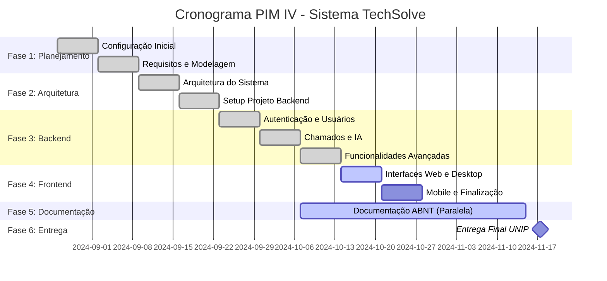
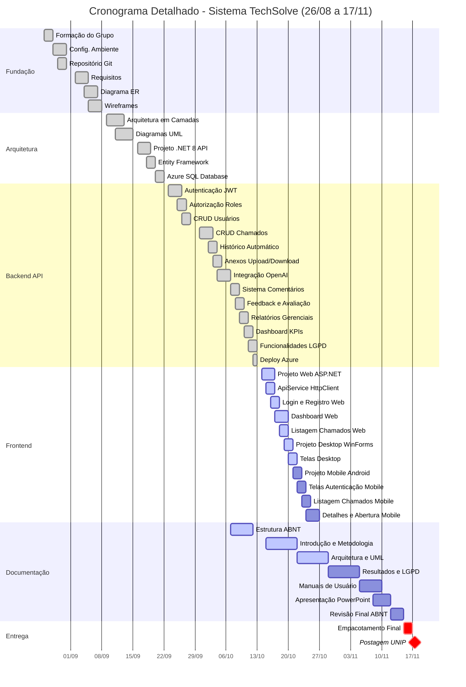

# Diagrama de Gantt - Cronograma PIM IV

## Sistema TechSolve - Cronograma Visual (26/08/2024 - 17/11/2024)



---

## Diagrama de Gantt Detalhado por Tarefas



---

## Marcos do Projeto (Milestones)

```mermaid
gantt
    title Marcos Principais - Sistema TechSolve
    dateFormat YYYY-MM-DD

    section Marcos
    M1: Formação do Grupo          :done, milestone, m1, 2024-08-30, 1d
    M2: Requisitos e Modelagem     :done, milestone, m2, 2024-09-08, 1d
    M3: Arquitetura e UML          :done, milestone, m3, 2024-09-22, 1d
    M4: API Funcional              :done, milestone, m4, 2024-10-13, 1d
    M5: Sistema Completo (3 UI)    :active, milestone, m5, 2024-10-27, 1d
    M6: Documentação ABNT          :milestone, m6, 2024-11-15, 1d
    M7: ENTREGA FINAL UNIP         :crit, milestone, m7, 2024-11-17, 1d
```

---

## Como Visualizar o Diagrama

### Opção 1: GitHub
Cole este arquivo no GitHub e os diagramas Mermaid serão renderizados automaticamente.

### Opção 2: Mermaid Live Editor
1. Acesse: https://mermaid.live/
2. Cole o código Mermaid
3. Visualize e exporte como PNG/SVG

### Opção 3: VS Code
1. Instale a extensão "Markdown Preview Mermaid Support"
2. Abra este arquivo e use a preview do Markdown

### Opção 4: Confluence/Notion
Ambas as plataformas suportam diagramas Mermaid nativamente.

---

**Legenda:**
- ✅ Verde (done): Tarefas concluídas
- 🔵 Azul (active): Tarefas em andamento
- ⚪ Branco: Tarefas pendentes
- 🔴 Vermelho (crit): Tarefas críticas
- 💎 Diamante (milestone): Marcos importantes

---

**Gerado em:** 21/10/2024
**Projeto:** Sistema TechSolve - PIM IV
**Prazo Final:** 17/11/2024
