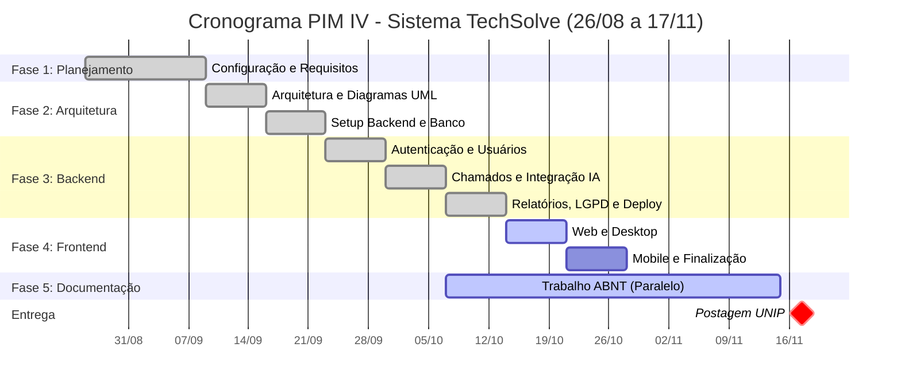

# Diagrama de Gantt - Cronograma PIM IV

## Sistema TechSolve - Cronograma Visual (26/08/2025 - 17/11/2025)

---

## Marcos do Projeto

| Marco | Data | Status |
|-------|------|--------|
| M1 - Formação do Grupo | 30/08/2025 | ✅ Concluído |
| M2 - Requisitos e ER | 08/09/2025 | ✅ Concluído |
| M3 - Arquitetura e UML | 22/09/2025 | ✅ Concluído |
| M4 - API Funcional | 13/10/2025 | ✅ Concluído |
| M5 - Sistema Completo | 27/10/2025 | 🔄 Em Andamento |
| M6 - Documentação ABNT | 15/11/2025 | 🔄 Em Andamento |
| M7 - **ENTREGA UNIP** | **17/11/2025** | ⏳ Pendente |

---

## Como Visualizar

**Opção 1: GitHub** - Cole este arquivo no GitHub para visualização automática

**Opção 2: Mermaid Live** - https://mermaid.live/ (cole o código)

**Opção 3: VS Code** - Instale a extensão "Markdown Preview Mermaid Support"

---

**Legenda:**
- ✅ Verde (done): Concluído
- 🔵 Azul (active): Em andamento
- ⚪ Branco: Pendente
- 🔴 Vermelho (crit): Crítico
- 💎 Diamante (milestone): Marco

**Gerado em:** 21/10/2025
